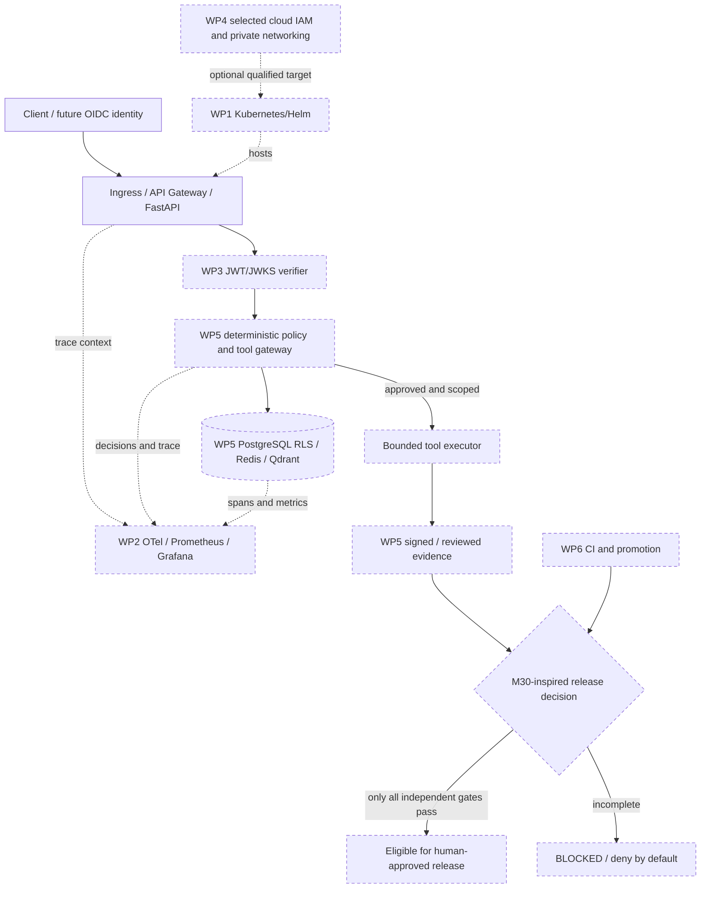

# AI Enterprise Governed Lab — Feasibility & Deployment

[](#qualification-status)

**Purpose:** A new, independent, GitHub-reviewable engineering baseline for enterprise AI integration and technical feasibility demonstrations. Integrate representative engineering capabilities from `ai_platform_setup_v3` and `portable-agentic-ai-governance`, without overwriting their histories, bypassing their approvals, or representing prototypes as certified enterprise software.

**Status (2026-11-20):** M0 design and a small executable local fixture are provided. WP1–WP6 are **planned work packages, not implemented/accepted**. The example API uses caller-supplied synthetic identity *only to exercise denial logic*, **not authentication**. M30 upstream freeze authorization remains **false**.

**Node1 complete setup, Git preservation and optional kind deployment:** [docs/Node1-Setup.md](docs/Node1-Setup.md).

## Quick start (Ubuntu 24.04, Python 3.10+)

```bash
python3 -m venv .venv
source .venv/bin/activate
python -m pip install -e '.[dev]'
bash scripts/preflight.sh
bash scripts/verify_baseline.sh
uvicorn feasibility.app:app --host 127.0.0.1 --port 18080
# in another terminal: bash scripts/smoke_local.sh
```

Optional local container test (requires Docker): `docker compose up --build -d && bash scripts/smoke_local.sh`; cleanup with `docker compose down`. Do not expose the demo API publicly or send real identities, tokens, PII or secrets into it.

## Architecture



*Dashed style means future integration, not completed functionality.* See [architecture](docs/Architecture.md), [instructions](docs/instruction.md), [milestones](docs/Milestones.md) and [acceptance](docs/Validation.md).

## Six sequential work packages

| WP | Deliverable | Evidence needed to call it accepted |
|---|---|---|
| WP1 Kubernetes | Local kind/K3s deployment, hardened Helm chart, namespace, probes, NetworkPolicy, Secret reference, rollout/rollback | Cluster manifest, live positive and negative probes, traffic, rollback and cleanup logs |
| WP2 Observability | OTel SDK/collector, spans across API/policy/data/tool, Prometheus, Grafana, incident playbook | Trace ID correlation, SLI dashboard, redacted logs, controlled failure and recovery |
| WP3 Identity | Real OIDC provider, JWKS key rollover, audience/issuer validation, verified tenant binding | Expired/wrong-aud/forged-tenant/key-rollover tests; deny by default |
| WP4 Cloud | One approved AWS or Azure reference deployment, Terraform plan/apply/destroy, IAM, private networking | Account authorization, cost guard, deployment evidence, network denial and teardown |
| WP5 Data + governance | R07, R09, R10 and M30 *reviewed adapters*, RLS, bounded action, evidence release gates | Cross-tenant attack tests, replay/fail-closed cases, signed provenance and human signoff |
| WP6 CI/CD | Supply-chain checks, test matrix, staged promotions, manual approval, rollback | Immutable image digests, provenance, locked dependencies, promotion/rollback evidence |

**Practical dependency note:** Design WP5's trust and evidence interfaces from M0; implement WP1–WP4 in order for demonstration, then integrate and qualify WP5, and place everything under WP6 promotion. Early WP1/2 demonstrations must not bypass WP3 authentication once the service becomes externally reachable.

## Qualification status

Read [`qualification/status.json`](qualification/status.json). **Only a small local M0 fixture exists**: minimal FastAPI `/livez`, `/readyz` (process-only), synthetic governed-read endpoint, pure default-deny policy, pytest, Helm templates, Docker baseline and GitHub Actions unit checks. There is no real JWKS, external tool, database, telemetry pipeline or cloud infrastructure yet.

## Source provenance and engineering rules

- Both uploaded source archives are **snapshots**; [`provenance/source-lock.json`](provenance/source-lock.json) records their content hashes, Git commit IDs and platform branch heads.
- The governance M30 working tree is **not committed** and freeze authorization is **false**. No implicit import, cherry-pick, merge, tag inheritance, or production acceptance.
- Do not copy entire original archives, `.git`, secrets, generated evidence or `.venv` into this repository. Review individual file licensing, owners and tests before integrating an adapter.
- Do not modify or push either upstream source repository as part of the new project.
- Baseline version proposal: `v0.1.0-m0` **only after** local/manual review. Future tags `v0.2.0-wp1` ... `v0.7.0-wp6` require independent acceptance. These tags are not created here.

## Navigation

- [`docs/Node1-Setup.md`](docs/Node1-Setup.md): detailed Node1 setup, rebranding verification, Git review, Docker/kind procedures and evidence
- [`docs/instruction.md`](docs/instruction.md): exact implementation sequence, dependencies and operations
- [`docs/Architecture.md`](docs/Architecture.md): system/container/sequence/trust diagrams and decisions
- [`docs/Milestones.md`](docs/Milestones.md): milestone contracts and gitGraph
- [`docs/Validation.md`](docs/Validation.md): command/test matrix and release gates
- [`docs/Source-Traceability.md`](docs/Source-Traceability.md): source-branch and milestone mapping
- [`docs/Security-Model.md`](docs/Security-Model.md): threat model and governance conditions
- [`docs/Runbook.md`](docs/Runbook.md): incident, verification and rollback drills
- [`docs/Interview-Demonstration.md`](docs/Interview-Demonstration.md): interview narrative and proof checklist
- [`docs/Commit-and-Release.md`](docs/Commit-and-Release.md): commit messages, tags, push and safeguards
- [`docs/Requirements-Crosswalk.md`](docs/Requirements-Crosswalk.md): platform R01–R16 and governance M0–M30 intake matrix
- [`docs/Implementation-Status.md`](docs/Implementation-Status.md): freshly verified work and explicit NOT_RUN blockers

### Node1 Docker recovery and Step 5 qualification

See [Node1 setup §5](docs/Node1-Setup.md) for the uploaded Docker-socket error, read-only daemon diagnostics, approved service recovery, and `scripts/wp0_compose_qualification.sh` (evidence-recording local-only smoke). This is **not** WP1 acceptance or production authorization.

## Node1 M0 Compose acceptance and WP1 work

The 2026-11-20 Node1 v2 logs and archived evidence support **M0 Docker Compose locally verified**. This is a synthetic FastAPI fixture with process-only `/readyz`, not real authenticated tenant isolation or a production service. See `qualification/m0-compose-local.json` and `docs/WP1-Node1-Qualification.md`. WP1 remains NOT_RUN and production authorization remains false.
