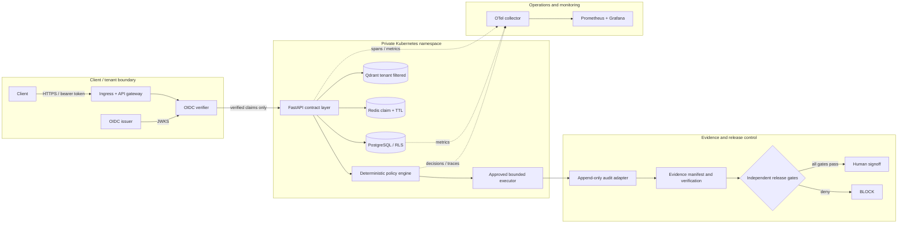
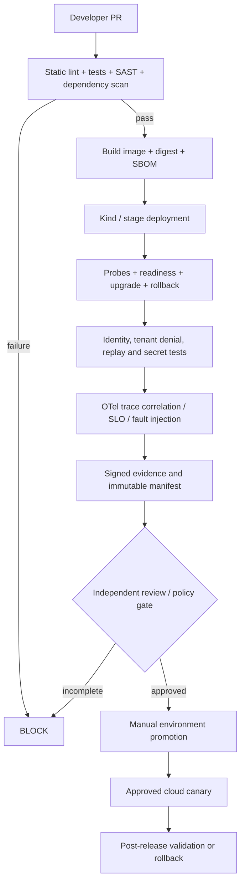
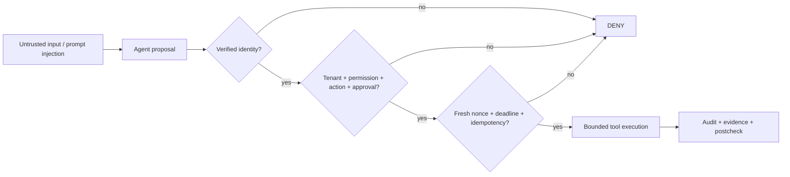
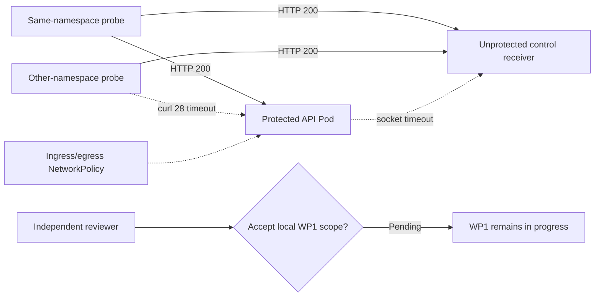

# Architecture — enterprise AI feasibility integration

## 1. Objectives, boundaries and decisions

**Primary:** prove that a client-specific AI API can run securely and observably inside a constrained Linux/Kubernetes environment, with reproducible deployment and denial/rollback evidence. Secondary: connect a real OIDC trust anchor, PostgreSQL tenant protection, Redis bounded claims and Qdrant tenant retrieval to a deterministic tool gateway. Tertiary: qualify one cloud environment and release gating.

**Non-goals:** cloud-independent blanket certification; autonomous direct hardware access; production compliance claims; exactly-once execution; M30 production authorization; mass migration of upstream source files. The current M0 fixture is deliberately *not* safe for deployment to untrusted networks because caller-supplied identity is unverified.

**Ownership:** new repo owns integration contracts, deployment, tests and evidence. `ai_platform_setup_v3` owns research branches R03/R05/R07/R09/R10. Governance source owns M0–M29, with M30 uncommitted. Maintain upstream signoff and license boundaries; do not import raw original `.git` or private evidence.

## 2. Target logical architecture (not currently deployed)



## 3. Trust / identity sequence

```mermaid
sequenceDiagram
 autonumber
 participant C as Client
 participant API as FastAPI
 participant JW as OIDC/JWKS validator
 participant POL as Deterministic policy
 participant PG as PostgreSQL RLS
 participant TOOL as Bounded tool
 participant EV as Audit/evidence
 C->>API: HTTPS request + access token + requested resource
 API->>JW: Verify signature, alg, kid, iss, aud, exp, nbf
 alt invalid token / missing trusted tenant binding
   JW-->>API: reject (401/403)
   API-->>C: denied; no side effect
 else verified principal + server-controlled tenant
   JW-->>API: verified principal / scopes / tenant
   API->>POL: normalized action, digest, principal, resource
   alt policy or scoped approval fails
     POL->>EV: sanitized denial record
     POL-->>C: deny; no tool call
   else allowed and within deadline
     POL->>PG: transaction-scoped authenticated tenant context
     Note over PG: Enforce RLS; resist session-setting spoofing
     POL->>TOOL: scoped command with expiry and idempotency key
     TOOL->>EV: result, audit, provenance, outcome
     TOOL-->>C: result via API
   end
 end
```

**Critical R09 constraint:** `current_setting('r09.tenant_id')` can be spoofed by a role that can set that GUC. The new implementation must not trust an application-supplied session variable as the sole tenant boundary. Candidate options: separate per-tenant roles/databases or tightly controlled SECURITY DEFINER / authenticated transaction context, assessed with a threat model, transaction-scoped settings and connection-pool negative tests. Do not mark WP5 complete merely because an RLS policy exists.

**Critical R10 constraint:** Redis `SET NX PX` proves a bounded atomic claim, not exactly-once execution. Design completion states, crash-recovery and compensating effects explicitly.

**Critical M30 constraint:** A signed receipt proves authenticity within its scope, **not** real-world security completeness. Release is blocked unless independent verifier, platform checks, authorized pentest and organizational evidence are all reviewed.

## 4. Deployment, observability and release flow



## 5. Runtime components and contracts

| Component | Contract | Failure behavior | Evidence |
|---|---|---|---|
| FastAPI | `/livez`, `/readyz`, authenticated `/v1/...`; versioned OpenAPI | input validation, 401/403, 429, 5xx with request ID | contract snapshots, curl/test reports |
| Identity | issuer/audience/alg/JWKS/rotation/expiry; verified tenant mapping | fail closed on unavailable or stale unverifiable keys | adversarial token suite |
| Policy | normalized action, explicit allow-list, approved scope/expiry | deny by default; zero side effect | decision log, negative tests |
| PostgreSQL | RLS with trusted tenant binding; least-privilege role | rollback on permission / transaction failure | cross-tenant DML tests |
| Redis | bounded claim/lease, idempotency state machine | no duplicate side effect unless approved safe replay | concurrent/crash tests |
| Qdrant | trusted tenant filter AND result post-validation | no cross-tenant payload escape | seeded multi-tenant tests |
| OTel | trace IDs across API/policy/data/tools; redact secrets | observability degradation never permits policy bypass | export queries, screenshot/JSON |
| Kubernetes | non-root, quotas, probes, NetworkPolicy, secrets | unhealthy deployment stops promotion; rollback | cluster rollout logs |
| Cloud | approved IAM/least privilege, private path, spend cap, destroy | no apply without explicit operator approval | plan, approval, teardown evidence |
| Release gate | signed manifests, independent verifier, unresolved blockers | `production_authorized=false` until independently reviewed | release decision report |

## 6. Threat model and qualification boundaries



**Source-of-truth migration approach:** for each adapter, produce `source branch + commit`, source file, license review, interface contract, before/after tests, threat analysis, and approval. `docs/Source-Traceability.md` is the initial ledger. All diagrams in this document are proposed WP1–WP6 targets except explicitly marked M0 fixture.


## November 20 v3 checkpoint

M0 Docker Compose qualification: **locally verified** using two Node1 runs and evidence checksum revalidation. `qualification/m0-compose-local.json` records the scope and provenance limits. WP1 now **IN_PROGRESS/UNACCEPTED** (initial kind rollout and rollback verified; NetworkPolicy and independent approval pending). Refer to `docs/WP1-Node1-Qualification.md` for dependency, manifest, rollback, CNI enforcement, security and evidence gates. Production remains denied.

## Node1 November 21 WP1 checkpoint (local research, not acceptance)

- Initial Helm rendering and kind deployment succeeded; Deployment, Service, ServiceAccount, and NetworkPolicy exist.
- Helm revision 2 was healthy (`ai-enterprise-feasibility:local`); revision 3 was the intentionally missing image; kubelet recorded `ErrImagePull` and `ImagePullBackOff`.
- After the Node1 reboot, Docker/containerd were inactive; existing kind node was recovered without replacement, kubeconfig refreshed, and Kubernetes became reachable.
- Helm revision 4 successfully rolled back to revision 2. Deployment generation 3 was observed, with one updated/ready/available replica and the correct image. Synthetic API checks returned liveness 200, process readiness 200, denied cross-tenant 403, and allowed same-tenant 200.
- The old Pod had one restart after reboot. This was not zero-downtime failover or a test of high availability.
- **NOT ACCEPTED:** NetworkPolicy enforcement has NOT been tested on this specific kindnet cluster (modern kindnet supports the NetworkPolicy API; test actual traffic); no real OIDC, enterprise secrets lifecycle, independently reviewed evidence, or production authorization.
- **Security:** the uploaded test archive included a kubeconfig backup under ignored `reports/validation`; exclude it from every distributed archive, rotate/revoke credentials if disclosure warrants, and do not publish it. Evidence hashing proves integrity only, not secrecy or trust.
- Updated scripts: `scripts/wp1_verify_live_recovery.sh` is a read-only live-state check; `scripts/wp1_capture_safe_evidence.sh` captures a minimal credential-free evidence subset; `scripts/smoke_local.sh` adds positive/negative HTTP checks; the kind helper now blocks ambiguous existing-node recovery.

### Node1 host-reboot and rollback sequence

```mermaid
sequenceDiagram
 participant Host as Node1/Docker
 participant Kind as Existing kind control plane
 participant K8s as Kubernetes Deployment
 participant Helm as Helm history
 Host->>Host: Start containerd and Docker
 Host->>Kind: Recover existing node (do not recreate)
 Kind-->>K8s: API reachable
 Helm-->>K8s: Revision 3 missing-image desired state
 K8s-->>Helm: ErrImagePull / ImagePullBackOff
 Helm->>K8s: Rollback to revision 2 (new revision 4)
 K8s-->>Helm: 1 updated, ready, available
 Note over Host,Helm: API 200/200/403 + synthetic allow 200; WP1 still partial
```

## WP1 tested network topology (November 21, 2026)



These five observations were recorded on one owned kind cluster, not production. The receiver had a transient startup warning before readiness passed. See `docs/WP1-Independent-Review.md` for integrity checks and remaining security boundaries.
