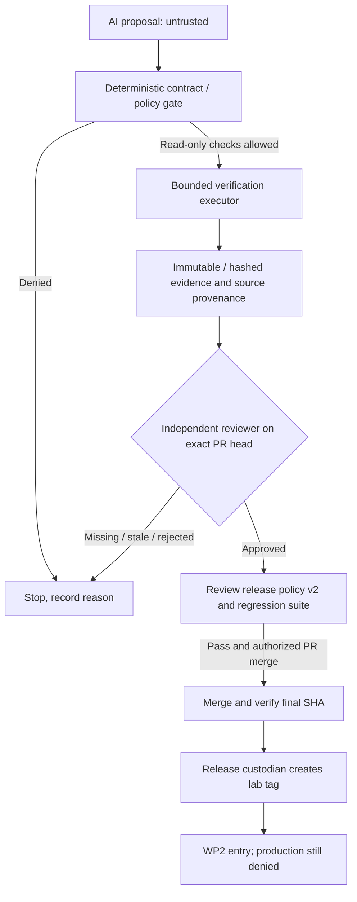

# Milestone governance — AI proposals, policy, bounded executor, evidence, independent release

The AI may suggest tasks and summarize evidence but has **no authority** to set `accepted`, approve an exception, grant RBAC permissions, bypass required checks, merge, or tag. A deterministic policy engine checks the exact milestone contract; the executor may perform only reviewed allowlisted tasks and records input/output/exit status. A separately authorized reviewer validates source identity, evidence digests, exceptions and the exact PR head. The release operator merges/tags only after protected review and post-merge checks. If any link is absent, deny the transition.

## Stage/record mapping

| Step | Input | Deterministic result | Human / external requirement |
|---|---|---|---|
| M0 accepted / WP1 in progress | `qualification/status.json` | local gate `READY_FOR_INDEPENDENT_REVIEW` | M0 source/evidence accepted historically |
| Contract frozen | `wp1-lab-contract.json` | exact gate inventory + explicit exclusions | Reviewed contract PR |
| Evidence source / digest | original `SHA256SUMS`, probe SHA256 | byte comparison, no rewrite | Original evidence integrity and independent custody |
| Independent approval | live GitHub PR reviews | eligible approver's latest review on exact HEAD | protected PR, allowed reviewer, human approval |
| Review release-policy v2 | proposed guard and negative tests | no premature acceptance, production always false | independent code review |
| Mark WP1 accepted (LAB only) | approval record referencing protected PR and approved exception | guarded transition | authorized release steward |
| Acceptance commit | reviewed diff | test suite and receipt verification | PR approval and protected branch |
| Merge | approved PR | post-merge SHA/readiness check | authorized maintainer |
| Tag | reviewed release SHA | annotated immutable-intent tag `v0.2.0-wp1-lab` | release custodian |
| WP2 entry | accepted local WP1 baseline | new feature branch; no production | WP2 observability contract and acceptance gates |

## Milestone mapping

| Milestone | Implementation | Proposed tag |
|---|---|---|
| M0 | Repository, provenance, architecture, documentation, fixture | `v0.1.0-m0` |
| M1 / WP1 | Kubernetes, hardened Helm, probes, networking, rollback | `v0.2.0-wp1-lab` (historical proposal `v0.2.0-wp1`; choose one under review) |
| M2 / WP2 | OpenTelemetry, Prometheus/Grafana, incident diagnosis | `v0.3.0-wp2` |
| M3 / WP3 | OIDC/JWKS, verified tenant context | `v0.4.0-wp3` |
| M4 / WP4 | Controlled cloud IAM, private networking, real Secrets | `v0.5.0-wp4` |
| M5 / WP5 | R07/R09/R10 and M30-style evidence controls | `v0.6.0-wp5` |
| M6 / WP6 | CI/CD, immutable artifacts, signing/provenance, staged promotion | `v0.7.0-wp6` |

**Scope:** The currently proposed WP1 local lab contract explicitly excludes real OIDC, managed Secret rotation/revocation, production high availability and production tenant isolation. `NOT_APPLICABLE` for application Secret provisioning is not a PASS for enterprise credential management. Reject acceptance if the approved WP1 contract does not permit this limited exception.

**Security limitation:** The supplied `--reviewer` and `--expected-head` parameters are operator inputs. A production-grade gate must load reviewer identities from a protected, independently approved policy source and verify branch protections/rulesets and review eligibility. GitHub review checks here are a read-only reference, never a substitute for the maintainer's actual approval. Do not put local kubeconfig, raw Secret data or unreviewed reports into a PR.

## Forward-deployed engineering and customer-specific evidence

A field engineer records enterprise-specific constraints as explicit, versioned inputs, not a free-form exception allowing AI to bypass controls. For a bank pilot, capture data classification/PII residency, existing core-system adapters, consent and retention obligations, authorization owners, latency SLO, approval obligations, incident escalation, customer-specific policy controls and evidence retention. The proposal interface can ask for a scoped verification action; deterministic policy and a separately approved customer contract decide whether it may run.

Customer adaptations follow `field finding -> risk/operations validation -> tenant-scoped contract -> isolated negative test -> independent reviewer -> reusable platform primitive`. An adapter that passes one customer sandbox is not globally approved. Preserve reusable patterns in the core only after tests against multiple tenant boundaries and a reviewed compatibility contract. Track success by lead time to safe deployment, audit/review turnaround, policy exception count, incident time-to-diagnosis, SLO compliance and adoption, not by model-demo quality alone.

### Milestone-specific productization

- WP1: reusable Kubernetes runtime, rollback and network-denial controls; single-node synthetic lab only.
- WP2: correlate workflow, policy, executor and customer incidents with OTel, Prometheus/Grafana; sensitive-field redaction.
- WP3: verified OIDC/JWKS, issuer/audience/expiry; tenant trust boundaries and bank entitlement integration.
- WP4: customer cloud/account isolation, private network, IAM and Secret integration with approved deployment plans.
- WP5: allowlisted R07/R09/R10 adapters, idempotency, database/vector tenant isolation and M30-independent evidence.
- WP6: signed immutable artifacts, SBOM/provenance, branch rules and controlled staged rollout.

No prior milestone acceptance automatically validates the next. The independent reviewer owns the scope decision; AI cannot impersonate the reviewer or write an approval receipt.
