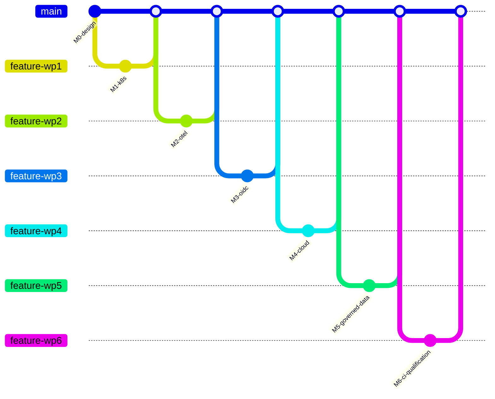
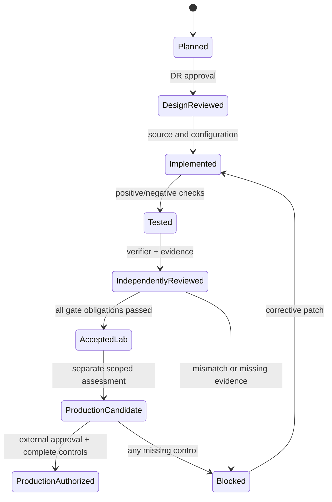

# Milestones and dependency contracts

| Milestone | Branch proposal | Tag proposal (do not create prematurely) | Prerequisite | Required acceptance evidence |
|---|---|---|---|---|
| M0 baseline | `feature/m0-import-and-design` | `v0.1.0-m0` | Two snapshot hashes, DR-0 | docs, source lock, local fixture tests, reviewers |
| M1 Kubernetes | `feature/wp1-kubernetes` | `v0.2.0-wp1` | M0, DR-1 | live cluster rollout, denial, rollback, chart, logs |
| M2 observability | `feature/wp2-observability` | `v0.3.0-wp2` | M1, DR-2 | trace/metric/log correlation and incident drill |
| M3 identity | `feature/wp3-oidc` | `v0.4.0-wp3` | M2, DR-3 | real JWKS, key rollover, forged tenant denials |
| M4 cloud | `feature/wp4-cloud` | `v0.5.0-wp4` | M3, DR-4 | provider review, IAM, network, plan/apply/destroy |
| M5 governed data | `feature/wp5-governed-data` | `v0.6.0-wp5` | M3/M4, DR-5 | R07/R09/R10/M30 adapter qualification |
| M6 release pipeline | `feature/wp6-cicd` | `v0.7.0-wp6` | M1–M5, DR-6 | independent gated pipeline, canary, rollback |

All tags identify **accepted lab milestones only**. Production authorization is independent and remains denied until a separate release board and evidence gate pass.

## Proposed new-repository Git development graph

*The graph is a future plan, not a representation of commits that have already occurred.* Preserving original research history means keep source project branches and tags completely unchanged. The new repo starts independently with provenance pointers.

## Acceptance state machine

## Implementation acceptance discipline

- Every report must state `PASS`, `FAIL`, `BLOCKED`, or `NOT_RUN`, not silently treat missing dependencies as success.
- A source branch head, an untracked file and a signed evidence artifact are not interchangeable.
- Require negative cases: wrong-tenant, unauthorized tool, forged JWKS, revoked approval, unavailable dependency, interrupted rollback and tampered evidence.
- Maintain milestone-specific `reports/validation/<timestamp>/` outside Git by default; publish only sanitized manifest summaries after review.

## November 20 v3 checkpoint

M0 Docker Compose qualification: **locally verified** using two Node1 runs and evidence checksum revalidation. `qualification/m0-compose-local.json` records the scope and provenance limits. WP1 now **IN_PROGRESS/UNACCEPTED** (initial kind rollout and rollback verified; NetworkPolicy and independent approval pending). Refer to `docs/WP1-Node1-Qualification.md` for dependency, manifest, rollback, CNI enforcement, security and evidence gates. Production remains denied.

## Node1 November 21 WP1 checkpoint (local research, not acceptance)

- Initial Helm rendering and kind deployment succeeded; Deployment, Service, ServiceAccount, and NetworkPolicy exist.
- Helm revision 2 was healthy (`ai-enterprise-feasibility:local`); revision 3 was the intentionally missing image; kubelet recorded `ErrImagePull` and `ImagePullBackOff`.
- After the Node1 reboot, Docker/containerd were inactive; existing kind node was recovered without replacement, kubeconfig refreshed, and Kubernetes became reachable.
- Helm revision 4 successfully rolled back to revision 2. Deployment generation 3 was observed, with one updated/ready/available replica and the correct image. Synthetic API checks returned liveness 200, process readiness 200, denied cross-tenant 403, and allowed same-tenant 200.
- The old Pod had one restart after reboot. This was not zero-downtime failover or a test of high availability.
- **NOT ACCEPTED:** NetworkPolicy enforcement has NOT been tested on this specific kindnet cluster (modern kindnet supports the NetworkPolicy API; test actual traffic); no real OIDC, enterprise secrets lifecycle, independently reviewed evidence, or production authorization.
- **Security:** the uploaded test archive included a kubeconfig backup under ignored `reports/validation`; exclude it from every distributed archive, rotate/revoke credentials if disclosure warrants, and do not publish it. Evidence hashing proves integrity only, not secrecy or trust.
- Updated scripts: `scripts/wp1_verify_live_recovery.sh` is a read-only live-state check; `scripts/wp1_capture_safe_evidence.sh` captures a minimal credential-free evidence subset; `scripts/smoke_local.sh` adds positive/negative HTTP checks; the kind helper now blocks ambiguous existing-node recovery.

## WP1 v5.4 status (2026-11-21)

Five-path kindnet behavior: **PASS, pending independent reviewer**. ServiceAccount `list secrets` and `create deployments`: **DENIED**. Credential-free fixture secret scope: N/A; managed Secret lifecycle and real OIDC: NOT_IMPLEMENTED. WP1 overall: **IN_PROGRESS**, M0 tag unchanged, production denied.
