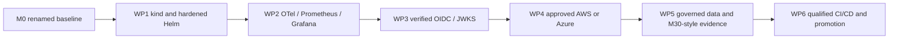

# Node1 installation, verification and next milestones

> Target: Ubuntu 24.04 Node1 in the independent `ai-enterprise-governed-lab` repository. This runbook is a **procedure**, not a record of executed Node1 tests. The project is an M0 local fixture. WP1–WP6 are unaccepted.

## 0. Inspect the existing Git checkout before changing it

The uploaded archive already contains `.git` with `main`, initial commit `819915f`, and an `origin` pointing to `https://github.com/studioraga/ai-enterprise-governed-lab.git`. The supplied M0 source files were **untracked** in the archive. Do not initialize a new repository, change remotes blindly, reset, or force-push.

```bash
cd ~/dev/pub/ai-enterprise/ai-enterprise-governed-lab
pwd
find . -maxdepth 2 -type f | sort | head -80
git status --short --branch
git branch -avv
git remote -v
git log -5 --oneline --decorate
git tag -l
```

If applying the corrected archive to an existing checkout, first back it up and compare the files; see **Section 1**. Do not overwrite any independently changed local code. Inspect the modified source and the remote before commit.

## 1. Apply the revised M0 files without replacing `.git`

**Recommended:** keep the existing Node1 repository and copy only the reviewed working files from the corrected delivery archive. For example, after placing `ai-enterprise-governed-lab-renamed.tar.gz` in `~/Downloads`:

```bash
cd ~/dev/pub/ai-enterprise
stamp="$(date -u +%Y%m%dT%H%M%SZ)"
cp -a ai-enterprise-governed-lab "ai-enterprise-governed-lab.backup.${stamp}"
mkdir -p "ai-enterprise-staging.${stamp}"
tar -tzf ~/Downloads/ai-enterprise-governed-lab-renamed.tar.gz | head -50
tar --no-same-owner -xzf ~/Downloads/ai-enterprise-governed-lab-renamed.tar.gz \
  -C "ai-enterprise-staging.${stamp}"
# Compare before applying. The supplied archive contains .git for provenance;
# deliberately exclude it when synchronizing updated working files.
diff -qr --exclude=.git ai-enterprise-governed-lab \
  "ai-enterprise-staging.${stamp}/ai-enterprise-governed-lab" || true
rsync -avn --exclude=.git \
  "ai-enterprise-staging.${stamp}/ai-enterprise-governed-lab/" \
  ai-enterprise-governed-lab/
# Only if you accept the reviewed differences:
rsync -av --exclude=.git \
  "ai-enterprise-staging.${stamp}/ai-enterprise-governed-lab/" \
  ai-enterprise-governed-lab/
```

Be careful: rsync does not delete old paths by default. Review `git status` and the identity guard for any residual files. An alternative is to use the corrected archive as a separate new worktree **if no local changes need preservation**; do not overlay the archive's `.git` on the existing checkout.

## 2. Verify the rename and repository metadata

```bash
cd ~/dev/pub/ai-enterprise/ai-enterprise-governed-lab
python3 scripts/verify_project_identity.py
python3 scripts/verify_source_lock.py
python3 scripts/check_no_production_claims.py
# Source-only search; exclude historical .git internals:
grep -RniE '(^|[^[:alnum:]])[Ii][Gg]([-_ ]|[Ll]abs)' \
  --exclude-dir=.git --exclude='*.pyc' . || true
# Inspect the remote separately; it is already the new project name:
git remote -v
```

The provenance **source archive SHA256 and upstream commit hashes must not be rewritten**: changing the new repository's name does not change inherited source-content identifiers. The new schema names reflect the renamed project; update code and data together. This is an internal schema version change, so old consumers would need migration if any exist.

## 3. Check dependencies and Python baseline

```bash
sudo apt-get update
sudo apt-get install -y python3-venv python3-pip git curl jq ca-certificates
python3 --version
git --version
cd ~/dev/pub/ai-enterprise/ai-enterprise-governed-lab
python3 -m venv .venv
source .venv/bin/activate
python -m pip install --upgrade pip
python -m pip install -e '.[dev]'
python -m pip check
bash scripts/preflight.sh
bash scripts/verify_baseline.sh
```

Expected Python test count from M0: **10**. Script also validates source-lock structure, default-deny production status and project identity. If Docker or Helm is missing, it prints **SKIP** for those optional checks; do not claim full WP1 qualification. Record Python/pip package versions and complete output for reproducibility.

### Record evidence

```bash
stamp="$(date -u +%Y%m%dT%H%M%SZ)"
mkdir -p "reports/validation/${stamp}"
python -m pip freeze > "reports/validation/${stamp}/pip-freeze.txt"
bash scripts/preflight.sh 2>&1 | tee "reports/validation/${stamp}/preflight.log"
set -o pipefail
bash scripts/verify_baseline.sh 2>&1 | tee "reports/validation/${stamp}/m0-verify.log"
sha256sum "reports/validation/${stamp}"/* > "reports/validation/${stamp}/SHA256SUMS"
sha256sum -c "reports/validation/${stamp}/SHA256SUMS"
```

Review logs for hostnames, tokens or secrets before any external sharing. `reports/validation/` is ignored by Git.

## 4. Local FastAPI positive and negative smoke checks

Terminal A:

```bash
cd ~/dev/pub/ai-enterprise/ai-enterprise-governed-lab
source .venv/bin/activate
uvicorn feasibility.app:app --host 127.0.0.1 --port 18080
```

Terminal B:

```bash
cd ~/dev/pub/ai-enterprise/ai-enterprise-governed-lab
curl -i http://127.0.0.1:18080/livez
curl -i http://127.0.0.1:18080/readyz
bash scripts/smoke_local.sh
```

The expected synthetic cross-tenant denial is HTTP **403**. The endpoint accepts caller-supplied demo identity: it is **not** authenticated. Do not bind the M0 app to a public interface, use real credentials, or infer security authorization from an HTTP 200 health check.

## 5. Corrected Docker Engine recovery and Docker Compose qualification (Node1)

**Observed 2026-11-20 Node1 log:** Docker Engine client 29.5.1 and Compose v5.1.3 are installed, but `docker info` cannot reach `unix:///var/run/docker.sock` (`connect: no such file or directory`). This is a **daemon not running / unavailable socket** condition until proven otherwise, NOT a Compose application failure. Python tests (10), local health/synthetic denial, source identity and Helm lint pass. `kind` and `aws` are absent; `kubectl`, `helm`, `terraform`, and `az` exist.

### 5.1 Read-only host diagnosis

```bash
bash scripts/diagnose_docker_node1.sh
systemctl status docker.service docker.socket containerd.service --no-pager -l
sudo journalctl -u docker.service -u containerd.service -b -n 100 --no-pager
```

Check for an override of `DOCKER_HOST` or `DOCKER_CONTEXT` before selecting the default socket. If Docker is intended to be rootless, inspect its user service and socket instead; do **not** use the rootful commands blindly.

### 5.2 Recover the standard Docker Engine daemon (only if the host uses rootful Docker)

```bash
sudo systemctl start containerd.service
sudo systemctl start docker.service
sudo systemctl status docker.service --no-pager -l
docker info
docker compose version
```

If the service is absent, inspect installed Docker packages and use the **approved Docker installation** procedure for Ubuntu 24.04. Do not reinstall if service exists and merely failed. If permission is denied (different error from the uploaded logs), check `id -nG` and socket permissions, then use a documented least-privilege access method. Membership in the `docker` group is effectively root-equivalent and should require explicit local authorization. Do not use `chmod 666 /var/run/docker.sock`, disable AppArmor/firewall, or delete Docker state. If Docker startup fails, collect `journalctl` and stop; do not assume a successful recovery.

### 5.3 Ensure local uvicorn no longer owns port 18080

```bash
ss -ltnp '( sport = :18080 )' || true
# Stop a still-running manual uvicorn process in its own terminal with Ctrl+C.
```

### 5.4 Execute the repeatable Compose check

```bash
cd ~/dev/pub/ai-enterprise/ai-enterprise-governed-lab
source .venv/bin/activate
bash scripts/wp0_compose_qualification.sh
# or after approving lab cleanup:
COMPOSE_CLEANUP=1 bash scripts/wp0_compose_qualification.sh
```

The script requires a reachable daemon; validates Compose config; builds the image; starts only the lab API; checks Docker `healthy`, HTTP `/livez` and `/readyz`, and the synthetic cross-tenant **403**; records logs and hashes in ignored `reports/validation/compose-*`. `COMPOSE_CLEANUP=1` stops only this lab's Compose resources. It does not delete volumes or run system-wide prune. Never execute this on an unapproved/shared Docker host.

Manual equivalents:

```bash
docker compose config --quiet
docker compose build --pull api
docker compose up -d --no-build api
docker compose ps
docker compose logs --tail=100 --no-color api
bash scripts/smoke_local.sh
docker compose down
```

**Acceptance:** daemon connected, image built, container healthy, HTTP 200 on health endpoints, synthetic denial HTTP 403, evidence saved. These are **M0 local Compose** results, not completed Kubernetes WP1 or enterprise security validation.

## 6. Helm static review before cluster creation

Verify Helm installation and chart rendering:

```bash
helm version
helm lint helm/feasibility
helm template feasibility helm/feasibility \
  --namespace ai-enterprise-feasibility \
  --set image.repository=ai-enterprise-feasibility \
  --set image.tag=local > /tmp/ai-enterprise-feasibility-rendered.yaml
sed -n '1,200p' /tmp/ai-enterprise-feasibility-rendered.yaml
```

Inspect all resulting resources. **WP1 remains partial:** the baseline chart does not yet implement a dedicated ServiceAccount, ingress, NetworkPolicy, resource quotas or external Secret references; these are pending design and qualification requirements, not optional production features.

## 7. Local kind cluster — strictly opt-in

Install and check Docker Engine, kind, kubectl and Helm through approved version-pinned methods. Confirm free resources, cgroup v2, CNI reachability and storage before running. `scripts/wp1_kind_qualification.sh` creates a disposable kind cluster if absent. Run **only on Node1**, not a shared or production cluster.

```bash
kind version
kubectl version --client
helm version
docker info
bash scripts/wp1_kind_qualification.sh
```

The script targets `kind-ai-enterprise-feasibility` explicitly. It builds `ai-enterprise-feasibility:local`, loads it into kind, installs Helm release `feasibility` in namespace `ai-enterprise-feasibility` and checks the deployment rollout. This is a **partial WP1** check; the absence of NetworkPolicy, secrets integration and rollback acceptance remains outstanding.

Inspect and run an HTTP smoke from a second terminal:

```bash
kubectl --context kind-ai-enterprise-feasibility \
  -n ai-enterprise-feasibility get deployment,service,pods -o wide
kubectl --context kind-ai-enterprise-feasibility \
  -n ai-enterprise-feasibility describe deployment feasibility-api
kubectl --context kind-ai-enterprise-feasibility \
  -n ai-enterprise-feasibility logs deployment/feasibility-api --tail=100
kubectl --context kind-ai-enterprise-feasibility \
  -n ai-enterprise-feasibility port-forward svc/feasibility-api 18080:8000
# Other terminal: bash scripts/smoke_local.sh
```

Before running port-forward, stop the local uvicorn or Compose service if it is already listening on 18080. Do not use `kubectl` without an explicit context in scripts or automation.

### Controlled rollback drill — only after approval

Record Helm revisions and the valid deployment/image first:

```bash
helm --kube-context kind-ai-enterprise-feasibility \
  -n ai-enterprise-feasibility history feasibility
kubectl --context kind-ai-enterprise-feasibility \
  -n ai-enterprise-feasibility get deploy feasibility-api -o yaml
```

Only in your isolated disposable cluster, introduce an intentionally unavailable image, observe a failed rollout, then rollback **to the recorded prior revision**. Do not invent the revision number; obtain it from the `helm history` output. Validate API health and denial behavior after rollback, capture events and exit codes. Never perform this drill in a shared cluster.

```bash
# Example lab-only negative test; run after manual approval:
helm --kube-context kind-ai-enterprise-feasibility \
  -n ai-enterprise-feasibility upgrade feasibility helm/feasibility \
  --set image.repository=ai-enterprise-feasibility \
  --set image.tag=missing-test-image
# Expected: rollout SHOULD FAIL. Capture failure without accepting it as a success.
kubectl --context kind-ai-enterprise-feasibility \
  -n ai-enterprise-feasibility rollout status deployment/feasibility-api --timeout=60s
# Choose the actual known-good revision from helm history:
helm --kube-context kind-ai-enterprise-feasibility \
  -n ai-enterprise-feasibility rollback feasibility <KNOWN_GOOD_REVISION>
```

After saving sanitized logs and confirming cluster ownership, cleanup is:

```bash
kind delete cluster --name ai-enterprise-feasibility
```

## 8. Review, commit, and push the M0 rename + baseline

Do not commit until all files are reviewed. The original archive has only initial commit `819915f`; the M0 project files are untracked. Stage the new files deliberately and inspect all staged content.

```bash
cd ~/dev/pub/ai-enterprise/ai-enterprise-governed-lab
git status --short
git diff --check
git add .github .gitignore .dockerignore Dockerfile LICENSE README.md \
  compose.yaml docs feasibility helm provenance pyproject.toml \
  qualification scripts tests
git diff --cached --stat
git diff --cached --check
git status --short
# Review staged secrets, unintended binaries, archived logs and provenance.
git diff --cached --name-only
```

Commit (after manual approval):

```bash
git commit -m 'feat(baseline): establish renamed AI enterprise governed lab M0' \
  -m 'Align image, kind cluster, Kubernetes namespace, provenance and qualification schema identifiers with ai-enterprise names.' \
  -m 'Preserve original Git history and upstream archive hashes; protect local kind context and Docker build context.' \
  -m 'Document Node1 environment setup, M0 verification, partial WP1 qualification and release-blocking gaps.' \
  -m 'Validation: local tests and rename guard required; WP1-WP6 production acceptance remains denied.'
git log -1 --format=fuller
git remote -v
```

The archive's existing origin uses HTTPS. Check your authentication setup and repository ownership. **Only after you have reviewed the new commit and confirmed the remote:** `git push -u origin main`. Do not use `git remote add origin` because it already exists. `git remote set-url origin git@github.com:studioraga/ai-enterprise-governed-lab.git` is optional if you prefer SSH and the destination has been verified.

### Proposed M0 tag (not automatically created)

When M0 local evidence and independent review are accepted:

```bash
git tag -a v0.1.0-m0 -m 'Reviewed local M0 baseline, not production authorized'
git show v0.1.0-m0 --stat
git push origin v0.1.0-m0
```

If the review is incomplete, leave the tag absent. Never force-push or claim WP1 acceptance from a partial kind deployment.

## 9. Future implementation dependency order



**WP1**: add verified image references, workload security, ServiceAccount/Secret, NetworkPolicy, negative probes and rollback evidence. **WP2**: correlated traces and failure injection. **WP3**: real OIDC issuer/JWKS, tenant ownership and denial tests. **WP4**: approved cloud IAM/network/secret/teardown. **WP5**: reviewed R07/R09/R10 adapters and independent evidence gates. **WP6**: immutable artifact CI/CD, scan/sign/promote/rollback and manual review. Update README, `docs/instruction.md`, `docs/Architecture.md`, `docs/Milestones.md`, `docs/Validation.md`, `docs/Runbook.md`, `docs/Source-Traceability.md` and qualification evidence **at every milestone** before creating any tag.
