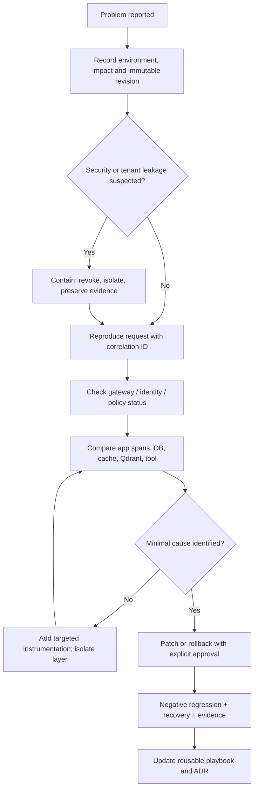

# Engineering runbook — setup, diagnosis, rollback

For a complete, step-numbered Node1 procedure and Git review, see [Node1-Setup.md](Node1-Setup.md).

## Local M0

```bash
bash scripts/preflight.sh
python3 -m venv .venv; . .venv/bin/activate
python -m pip install -e '.[dev]'
bash scripts/verify_baseline.sh
uvicorn feasibility.app:app --host 127.0.0.1 --port 18080
```

In another terminal run `bash scripts/smoke_local.sh`. If port 18080 is busy, choose a new port and set `BASE_URL=http://127.0.0.1:<port>`. Ensure source root is current directory. M0 uses only synthetic response data and must not be exposed remotely.

## Docker (optional)

```bash
docker compose config
docker compose up --build -d
docker compose ps
docker compose logs --no-color --tail=100 api
bash scripts/smoke_local.sh
docker compose down
```

`docker compose down` removes containers and network; inspect retained local images separately. A Docker binary without a healthy daemon must be reported as BLOCKED, not PASS.

## Kubernetes WP1 (requires approved kind, Docker, kubectl, Helm)

```bash
bash scripts/wp1_kind_qualification.sh
kubectl --context kind-ai-enterprise-feasibility -n ai-enterprise-feasibility get pods -o wide
kubectl --context kind-ai-enterprise-feasibility -n ai-enterprise-feasibility describe deploy feasibility-api
kubectl --context kind-ai-enterprise-feasibility -n ai-enterprise-feasibility logs deploy/feasibility-api
kubectl --context kind-ai-enterprise-feasibility -n ai-enterprise-feasibility port-forward svc/feasibility-api 18080:8000
# from another terminal: bash scripts/smoke_local.sh
```

**Rollback drill (planned acceptance, disposable kind cluster only):** record Helm revision/digest, deploy an intentionally invalid image in the lab, observe rollout failure, `helm --kube-context kind-ai-enterprise-feasibility -n ai-enterprise-feasibility rollback feasibility <recorded-prior-revision>`, verify readiness and denied cross-tenant action, record events and cleanup. Do not perform deliberate failure on a shared or production cluster. `kind delete cluster --name ai-enterprise-feasibility` only after operator confirms this is an owned disposable cluster.

## Incident diagnosis flow



## Evidence handling

Create a uniquely timestamped local `reports/validation/<timestamp>/` folder (ignored by Git), capture sanitized command output and tool versions. Generate SHA256 manifest, verify via a second process or host, and record `PASS/FAIL/BLOCKED/NOT_RUN`. Mask host IPs, real principal names, passwords, JWTs, cloud account IDs and sensitive application payloads before sharing.

## Common failures and first checks

| Symptom | First checks | Never infer |
|---|---|---|
| App healthy but API 401 | IdP issuer/audience/JWKS/kid, proxy forwarded headers, clock | that policy allowed an action |
| 403 same-tenant | entitlement mapping, resource ownership, approval, scopes, DB role | bypass checks to make demo pass |
| RLS invisible rows | active role, transaction context, `FORCE RLS`, pool reuse | tenant data absent |
| Slow Qdrant | filtering cardinality, collection config, network, index, traces | model hallucination |
| Redis duplicate effects | claim TTL, completion, crash window, replay token | exactly-once guarantees |
| Kubernetes readiness failure | events, image digest, pull, probes, permissions, DNS | cluster is production ready |
| Valid signed release receipt | check actual independent controls and veto gates | release authorization |

## Docker Engine unavailable on Node1 (2026-11-20)

A working Docker CLI and Compose plugin do not imply an operational daemon. If `docker info` reports `dial unix /var/run/docker.sock: connect: no such file or directory`, run `bash scripts/diagnose_docker_node1.sh`, inspect `systemctl status docker.service docker.socket containerd.service` and journal logs, then start existing rootful services **only when appropriate for the host**. Never loosen socket permissions or wipe `/var/lib/docker` to bypass errors. Once `docker info` confirms a Server section, execute `bash scripts/wp0_compose_qualification.sh`. Evidence goes into ignored `reports/validation/compose-*`. This is M0 qualification only.


## November 20 v3 checkpoint

M0 Docker Compose qualification: **locally verified** using two Node1 runs and evidence checksum revalidation. `qualification/m0-compose-local.json` records the scope and provenance limits. WP1 now **IN_PROGRESS/UNACCEPTED** (initial kind rollout and rollback verified; NetworkPolicy and independent approval pending). Refer to `docs/WP1-Node1-Qualification.md` for dependency, manifest, rollback, CNI enforcement, security and evidence gates. Production remains denied.

## Node1 November 21 WP1 checkpoint (local research, not acceptance)

- Initial Helm rendering and kind deployment succeeded; Deployment, Service, ServiceAccount, and NetworkPolicy exist.
- Helm revision 2 was healthy (`ai-enterprise-feasibility:local`); revision 3 was the intentionally missing image; kubelet recorded `ErrImagePull` and `ImagePullBackOff`.
- After the Node1 reboot, Docker/containerd were inactive; existing kind node was recovered without replacement, kubeconfig refreshed, and Kubernetes became reachable.
- Helm revision 4 successfully rolled back to revision 2. Deployment generation 3 was observed, with one updated/ready/available replica and the correct image. Synthetic API checks returned liveness 200, process readiness 200, denied cross-tenant 403, and allowed same-tenant 200.
- The old Pod had one restart after reboot. This was not zero-downtime failover or a test of high availability.
- **NOT ACCEPTED:** NetworkPolicy enforcement has NOT been tested on this specific kindnet cluster (modern kindnet supports the NetworkPolicy API; test actual traffic); no real OIDC, enterprise secrets lifecycle, independently reviewed evidence, or production authorization.
- **Security:** the uploaded test archive included a kubeconfig backup under ignored `reports/validation`; exclude it from every distributed archive, rotate/revoke credentials if disclosure warrants, and do not publish it. Evidence hashing proves integrity only, not secrecy or trust.
- Updated scripts: `scripts/wp1_verify_live_recovery.sh` is a read-only live-state check; `scripts/wp1_capture_safe_evidence.sh` captures a minimal credential-free evidence subset; `scripts/smoke_local.sh` adds positive/negative HTTP checks; the kind helper now blocks ambiguous existing-node recovery.


## WP1 progress and M0 evidence verifier (2026-11-21 correction)

The M0 record's `wp1_status: NOT_RUN` is historical (at M0 qualification).
`qualification/status.json` is the current milestone state and may advance WP1
from `planned` to `in_progress`, and eventually to `accepted` only after independent review.
The M0 verifier is milestone-independent; the separate release guard protects
current policy while WP1 remains unaccepted.
`scripts/verify_m0_compose_record.py` checks both invariants separately, and
checks the recorded SHA-256 digest of each M0 manifest as well as file hashes.
Run `python3 scripts/verify_m0_compose_record.py --require-evidence` on Node1;
CI without Node1's ignored reports checks the record structure but must show
`NOT_PRESENT` for evidence rather than a false PASS.

After initial CNI tests, confirm a denied request is not merely DNS/image/runtime
failure; verify positive connectivity and the kindnet enforcement version.

## WP1 temporary network probe leftovers

After v5.1 initial traffic probing, `wp1-same-ns` and the namespace
`ai-enterprise-wp1-probe` can remain. The corrected differential probe also
uses a third, separately labeled `wp1-control-receiver` Pod. Inspect exact
objects and ownership before deletion; remove only these named lab resources.
The network probe deliberately preserves objects on success and failure.
A timeout is counted as a tested denial only after cross-namespace connectivity
to the unprotected receiver and same-namespace connectivity both pass.


## WP1 v5.3 receiver-readiness correction (2026-11-21)

The Node1 v5.2 differential probe started all three disposable Pods but failed
on the *same-namespace to unprotected receiver* positive control with
`curl: (7) Failed to connect to <receiver-pod-ip>:8000` (exit 7).
This is **not proof of NetworkPolicy denial**: the receiver was created with
`kubectl run` without a readinessProbe, so Pod Ready did not guarantee Uvicorn
had bound port 8000. Inspect the retained receiver logs and local HTTP response
before attributing the failure to startup timing; a command/entrypoint error
remains possible until diagnosed.

The corrected probe creates a labeled receiver Pod with startup and HTTP readiness
probes, non-root identity, no service-account token, a read-only root filesystem
and restricted capabilities. It also verifies receiver-loopback HTTP 200 before
proceeding to three positive cross-Pod controls and two expected timeout denials.
If loopback is unavailable, the test is BLOCKED, not a policy failure or PASS.
Preserve the failed probe's evidence and inspect ownership before manually
deleting exactly the test Pods and test namespace. Do not delete the application,
Helm release or kind cluster. Re-run once and record CNI details, Pod IPs,
control successes, denial error types and SHA-256 evidence before review.
WP1 remains IN_PROGRESS; production authorization stays denied.

## WP1 v5.4 evidence and RBAC unblocking

Do not edit/re-hash `reports/validation/wp1-network-v5.3-20261121T052723Z/`: its operator summary has placeholders, but the original hashed bundle must remain intact. Write interpretations to a separate review directory. If `kubectl auth can-i --as=...` fails due to impersonation restrictions, request authorized review; **do not grant privileges to force the test to pass**. The fixture requires no application Secrets, so mark provisioning N/A, while enterprise Secret lifecycle remains NOT_IMPLEMENTED. Do not include kubeconfig or raw Secrets in shared archives.
