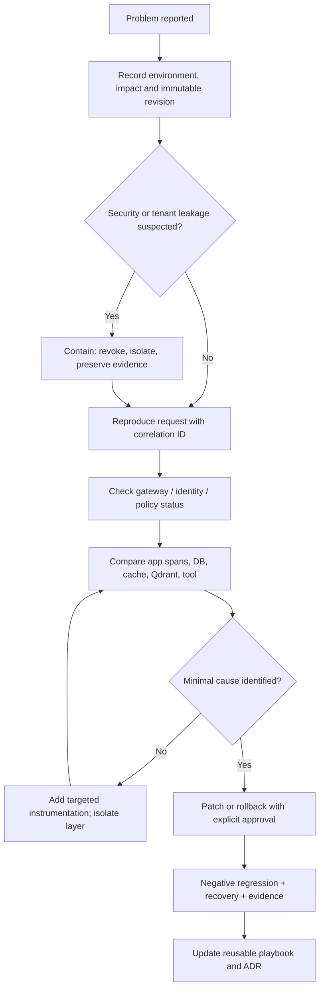

# Engineering runbook — setup, diagnosis, rollback

For a complete, step-numbered Node1 procedure and Git review, see [Node1-Setup.md](Node1-Setup.md).

## Local M0

```bash
bash scripts/preflight.sh
python3 -m venv .venv; . .venv/bin/activate
python -m pip install -e '.[dev]'
bash scripts/verify_baseline.sh
uvicorn feasibility.app:app --host 127.0.0.1 --port 18080
```

In another terminal run `bash scripts/smoke_local.sh`. If port 18080 is busy, choose a new port and set `BASE_URL=http://127.0.0.1:<port>`. Ensure source root is current directory. M0 uses only synthetic response data and must not be exposed remotely.

## Docker (optional)

```bash
docker compose config
docker compose up --build -d
docker compose ps
docker compose logs --no-color --tail=100 api
bash scripts/smoke_local.sh
docker compose down
```

`docker compose down` removes containers and network; inspect retained local images separately. A Docker binary without a healthy daemon must be reported as BLOCKED, not PASS.

## Kubernetes WP1 (requires approved kind, Docker, kubectl, Helm)

```bash
bash scripts/wp1_kind_qualification.sh
kubectl --context kind-ai-enterprise-feasibility -n ai-enterprise-feasibility get pods -o wide
kubectl --context kind-ai-enterprise-feasibility -n ai-enterprise-feasibility describe deploy feasibility-api
kubectl --context kind-ai-enterprise-feasibility -n ai-enterprise-feasibility logs deploy/feasibility-api
kubectl --context kind-ai-enterprise-feasibility -n ai-enterprise-feasibility port-forward svc/feasibility-api 18080:8000
# from another terminal: bash scripts/smoke_local.sh
```

**Rollback drill (planned acceptance, disposable kind cluster only):** record Helm revision/digest, deploy an intentionally invalid image in the lab, observe rollout failure, `helm --kube-context kind-ai-enterprise-feasibility -n ai-enterprise-feasibility rollback feasibility <recorded-prior-revision>`, verify readiness and denied cross-tenant action, record events and cleanup. Do not perform deliberate failure on a shared or production cluster. `kind delete cluster --name ai-enterprise-feasibility` only after operator confirms this is an owned disposable cluster.

## Incident diagnosis flow



## Evidence handling

Create a uniquely timestamped local `reports/validation/<timestamp>/` folder (ignored by Git), capture sanitized command output and tool versions. Generate SHA256 manifest, verify via a second process or host, and record `PASS/FAIL/BLOCKED/NOT_RUN`. Mask host IPs, real principal names, passwords, JWTs, cloud account IDs and sensitive application payloads before sharing.

## Common failures and first checks

| Symptom | First checks | Never infer |
|---|---|---|
| App healthy but API 401 | IdP issuer/audience/JWKS/kid, proxy forwarded headers, clock | that policy allowed an action |
| 403 same-tenant | entitlement mapping, resource ownership, approval, scopes, DB role | bypass checks to make demo pass |
| RLS invisible rows | active role, transaction context, `FORCE RLS`, pool reuse | tenant data absent |
| Slow Qdrant | filtering cardinality, collection config, network, index, traces | model hallucination |
| Redis duplicate effects | claim TTL, completion, crash window, replay token | exactly-once guarantees |
| Kubernetes readiness failure | events, image digest, pull, probes, permissions, DNS | cluster is production ready |
| Valid signed release receipt | check actual independent controls and veto gates | release authorization |

## Docker Engine unavailable on Node1 (2026-11-20)

A working Docker CLI and Compose plugin do not imply an operational daemon. If `docker info` reports `dial unix /var/run/docker.sock: connect: no such file or directory`, run `bash scripts/diagnose_docker_node1.sh`, inspect `systemctl status docker.service docker.socket containerd.service` and journal logs, then start existing rootful services **only when appropriate for the host**. Never loosen socket permissions or wipe `/var/lib/docker` to bypass errors. Once `docker info` confirms a Server section, execute `bash scripts/wp0_compose_qualification.sh`. Evidence goes into ignored `reports/validation/compose-*`. This is M0 qualification only.


## November 20 v3 checkpoint

M0 Docker Compose qualification: **locally verified** using two Node1 runs and evidence checksum revalidation. `qualification/m0-compose-local.json` records the scope and provenance limits. WP1 still **NOT_RUN/UNACCEPTED**. Refer to `docs/WP1-Node1-Qualification.md` for dependency, manifest, rollback, CNI enforcement, security and evidence gates. Production remains denied.
