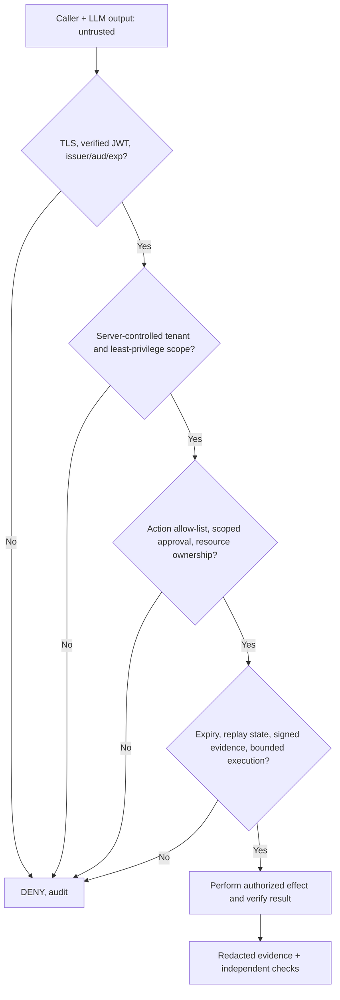

# Security requirements and threat model

## Trust boundaries

External callers and their request bodies, LLM completions, tool arguments, document retrieval results, cache state, database rows, upstream release reports and CI artifacts are **untrusted by default**. Only a separately verified identity provider and explicitly approved human/environment control chain may establish privilege.

## Threats and expected defensive tests

| Threat | Design control | Negative proof |
|---|---|---|
| Fake token / algorithm confusion | fixed approved signing algorithms, JWKS signature, issuer/audience | forged, swapped `kid`, HS/RS confusion, expired |
| Forged tenant in JSON or headers | derive tenant from verified principal + server-side entitlement | body/header spoof blocked |
| SQL session tenant-variable spoof | avoid blindly trusting custom `SET` GUC; scoped DB role/context | malicious `SET`, pool reuse, transaction interleaving |
| Vector cross-tenant leak | trusted tenant filter plus payload validation | wrong-tenant injected hit blocked |
| Duplicate tool effects | replay and idempotency state machine with expiration | concurrent duplicate, crash and restart |
| Agent prompt injection | LLM never authorizes action; deterministic policy and tool allow-list | malicious prompt suggesting unrestricted tool rejected |
| Approval reuse | signed scoped approval, one-time nonce, deadline | expired, altered args, different resource rejected |
| Network lateral movement | Kubernetes NetworkPolicy, egress restrictions and private cloud | blocked destination cannot be reached |
| Compromised secret | short-lived managed identity, rotation and redaction | revoked key fails; no logs/telemetry leaks |
| Supply chain tamper | immutable digests, SBOM, attestation, code-owner approval | mismatched image or evidence digest denied |
| Evidence laundering | independent verifier and real-world release gates | valid signature + missing secure boot still denied |

## Production release blockers

- Synthetic demo identity is **not** authentication and must be removed from all trusted routes.
- Upstream M30 records release `freeze_authorized=false`; this project must not relabel the upstream evidence.
- R09 custom-GUC tenant isolation, R10 exactly-once limitations and R07 research-only controls must be addressed before acceptance.
- Real IdP, secure cluster networking, secrets and key lifecycle, external penetration-test authorization, evidence retention, platform security, organizational/BCP evidence and human approvals are mandatory when applicable to the target.
- Secret material stays out of Git, CI logs and public demo traces. Never publish private evidence bundles.

## Data minimization and audit

Audit: request ID, hashed/non-sensitive principal identifier, tenant scope ID, action digest, decision, reason category, tool result digest, timestamps and verifier chain. Do not log JWT, prompts containing PII, raw secrets or customer documents. Define retention/deletion, evidence ACLs, backup/encryption and key rotation before real client data.
