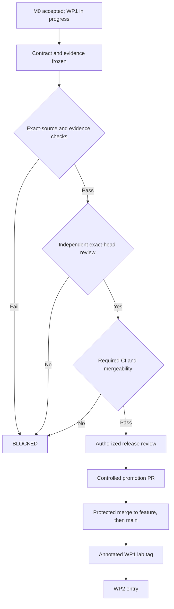

# WP1 v5.7.1 correction and release-gate boundary

This **overlay** repairs the incomplete v5.7 tarball. It provides the missing `scripts/wp1_live_release_gate.py`, its regression tests, and the missing CI workflow. Existing source and original lab evidence are retained.

## Failure triage

- `cd ai-enterprise-governed-lab` from inside the same directory is a path error. Run `cd ~/dev/pub/ai-enterprise/ai-enterprise-governed-lab`.
- A failed archive SHA-256 check is a hard stop. Do not assert the old archive is authentic; use the fresh overlay and its manifest.
- Never hash a manifest *into itself*: `FILE_SHA256SUMS` is excluded from the manifest; verify using `sha256sum -c FILE_SHA256SUMS`.
- Do not rename or rebase the merged review branch to force a second PR. PR #1 is already merged to `origin/feature/wp1-kubernetes-integration` at `f0ee81c` in the uploaded snapshot.
- A dirty working tree on `review/wp1-lab-acceptance` cannot safely pass the branch-preparation script; preserve the uncommitted four files and make a separate clean feature-based review branch.

## Required authority checks

The read-only live gate requires a fresh open PR with frozen exact head SHA, independent allowlisted approval, GitHub `APPROVED` review decision, `MERGEABLE` state and at least one **required** passing check. The allowlist must be administered outside the PR's trust boundary. A CLI-supplied allowlist is only a sample; it is not organizational authority by itself.

The source CI workflow cannot establish an independent reviewer or access original local evidence. Configure a repository ruleset to require approval and the `governance-source` check; never use `--admin` or force push for a release.

## Exit codes and acceptance

The gate returns zero only for `READY_FOR_AUTHORIZED_MERGE`, which is **not** approval to merge. It returns 2 for blocked/missing requirements and never mutates the repository, Kubernetes, or GitHub. Do not mark WP1 accepted, merge, or tag while Secret exception and independent acceptance are pending.

## State machine

